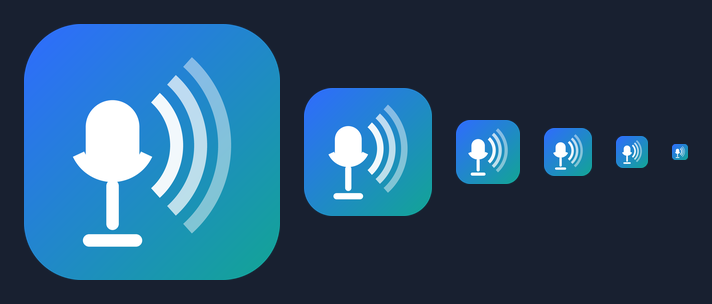

# MicCast · 声渡

把鸿蒙手机当作 Windows 电脑的麦克风。

> 虚拟声卡推荐 [VB-CABLE](https://vb-audio.com/Cable/)（VB-Audio 出品，donationware，本项目不附带其安装包）。
> 许可：[MIT](LICENSE)　·　后续迭代计划见 [ROADMAP.md](ROADMAP.md)



图标由 [tools/make-icon.py](tools/make-icon.py) 生成（圆角渐变底 + 白色麦克风 + 声波弧），
一次产出手机端 `app_icon.png` / `icon.png`、Hero 用的透明底 `brand_mark.png`、
Windows 的 `app.ico`（16/24/32/48/64/128/256）以及多尺寸预览图。
改设计只需改这一个脚本，两端自动保持一致。

```
鸿蒙手机（服务端）                         Windows（MicCast Receiver）
┌──────────────────────────┐             ┌─────────────────────────────────┐
│ TCP  59100  监听/握手     │ ◄────────── │ 连过来握手                      │
│ UDP  59200  广播自身      │ ──────────► │ 自动发现，列表里直接选           │
│ UDP  59100  推 PCM        │ ──────────► │ 收 StreamData → NAudio          │
│ AudioCapturer 48k/2ch     │             │   ↓ WasapiOut                   │
│ 每 2s 发 PingRequest      │             │ CABLE Input                     │
└──────────────────────────┘             └─────────────────────────────────┘
                                                         ↓ ══ VB-CABLE ══
                                                        CABLE Output
                                                         ↓
                                        微信 / 腾讯会议 / Discord / Win+H 选它当麦克风
```

- **包名**：`com.local.miccast`
- **服务端广播名**：`<机型> (MicCast)`，例如 `P60 (MicCast)`
- **线缆协议**：字段号沿用 AudioRelay 0.27.5 的 protobuf schema（从本机 `Model.dll` 反射核对）。
  之所以还沿用这套格式，是因为手机端与接收端都在本仓库内、协议本身够用，
  改动它只会带来无谓的联调成本 —— 但**官方 App 收不了我们推的流**（见下方「协议设计上踩过的三个坑」）。

## 端到端实测

| 环节 | 证据 |
|---|---|
| 手机启动服务 | `tcp listening 0.0.0.0:59100` + `discovery broadcast started (udp/59200)` |
| **自动发现** | `发现设备: <机型> (MicCast) @ 192.168.1.23` |
| 手机推流 | **200 帧/秒**（5ms/帧），`sentOk` 持续增长、`sendErr=0` |
| 接收端收流 | `fps=200 kbps=1533 buffered=75ms device=CABLE Input (VB-Audio Virtual Cable)` |
| **Windows 拿到真麦克风** | 从 `CABLE Output` 录 30s：`mean_volume=-33.8 dB` / `max_volume=-2.5 dB` |
| 对比：某些 App 自带的 Virtual Mic | −91 dB（纯静音），不可用 |

真机：HarmonyOS 手机（API 26 / OpenHarmony 7.0），Windows 11 + VB-CABLE 3.5.2.0。

## 手机端

### 界面

- **顶部渐变 Hero**：应用名 + 副标题 + 状态胶囊（`未启动` / `等待电脑连接` / `正在串流`）
- 串流时 Hero 变成唯一的实时状态区：
  - **麦克风电平条**（把采集到的 PCM 直接算 RMS 再转 dB），一眼能看出手机到底有没有在收音
  - 一行三个**速率类**指标：已串流时长 / 帧/秒 / kbps
    —— 刻意不显示"累计帧数"这种只增不减的计数器，对用户没有意义还会造成焦虑
- 主操作卡片：说明文字随状态变化 + 一个圆角主按钮
- **采集模式切换**（主操作卡内三段式选择器）：串流中也能切，切换只重建采集器、不断开连接
- 「电脑上怎么用」四步指引，带编号圆标，可折叠
- 运行日志默认**收起**，只有展开时才刷新内容
- **动效**：电平条跟随有缓动、开始/停止按钮颜色过渡 + 按下缩放回弹、Hero 实时区滑入淡出、
  指引与日志展开用 `animateTo` 平滑过渡
- 深浅色跟随系统：`resources/base/element/color.json`（浅色）与 `resources/dark/element/color.json`（深色）两套配色，`EntryAbility` 里 `setColorMode(COLOR_MODE_NOT_SET)`

### 行为

- 点「启动麦克风服务」→ 监听 TCP 59100 + 每 2 秒广播发现包
- 电脑端连上 → 自动申请麦克风权限、启动采集、申请 `audioRecording` 长时任务
- **电脑端断开 → 自动停掉采集与长时任务**，状态回到「等待电脑连接」

### 采集模式

系统对不同的 `AudioCapturer` 源套用不同的音频处理链，效果因机型而异：

| 模式 | SourceType | 说明 |
|---|---|---|
| 原始 | `SOURCE_TYPE_MIC` | 不做任何处理，最保真，适合安静环境 |
| 语音增强 | `SOURCE_TYPE_VOICE_COMMUNICATION` | 系统语音通信处理链，含 AEC + 降噪 + 自动增益 |
| 识别优先 | `SOURCE_TYPE_VOICE_RECOGNITION` | 偏语音识别优化的处理链 |

实测（同一台机器、同一环境、同一段 TTS 音源）：

| 模式 | 开局底噪 | 收尾底噪（说完后） | 有声峰值 | 过零率 |
|---|---|---|---|---|
| 原始 | −26.2 dBFS | **−34.1** | −12.6 | 0.1541 |
| 语音增强 | −27.4 dBFS | **−75.0** | −12.9 | 0.1692 |
| 识别优先 | −27.7 dBFS | **−71.7** | −12.5 | 0.1651 |

**语音增强的副作用**（听感比数字更明显，可用 `tools/record-cable.ps1` 复现）：

- **抽吸感（pumping）**：停顿处被压掉 41dB 变成绝对安静，一开口 AGC 又把增益推上来，
  部分帧比原始响 16dB。主观感受是「死寂 → 突然变响 → 迅速消失」
- **句尾辅音丢失**：s / sh / f 能量低，容易被判成噪声削掉
- 过零率反而比原始高，所以**不是发闷**，纯粹是动态被改变了

因此手机端**默认用「原始」**（`AudioSender` 里 `mode` 的初值）。默认应该是最少意外的那档，
需要降噪的人自己在界面上切过去。

**串流中切换不会断开连接**：`AudioSender.setMode()` 只做「停旧采集器 → 建新采集器」，
UDP 推流通道保持不变（重建 UDP socket 会重新 bind 59100，旧 socket 尚未释放时会冲突）。
切换瞬间有约 100ms 断音，属正常。

### 构建 / 装机

前置：`devecocli`（`pnpm add -g --config.node-linker=hoisted @deveco/deveco-cli`）或直接用 DevEco Studio。

```powershell
# 按自己的安装位置调整
$env:PATH = '<DevEco Studio>\tools\node;<pnpm 目录>;' + $env:PATH
$env:DEVECO_HOME = '<DevEco Studio>'

devecocli auth login --no-prompt
devecocli signature generate --type debug    # 首次或改了 bundleName 后执行，会把 signingConfigs 写进 build-profile.json5
devecocli build --modules entry
devecocli run --skip-build --module entry --device <手机IP:端口> --ability EntryAbility
```

`<手机IP:端口>` 由 `hdc tconn <手机IP>:<端口>` 建立，端口在手机的「开发者选项 → 无线调试」里。

> 仓库里的 `build-profile.json5` 是**不含签名信息**的模板；`signature generate` 会自动补上
> `signingConfigs`，证书默认落在 `~/.ohos/config/`。

## 电脑端

要点：

1. 界面为自绘现代风格（深浅色跟随系统，Windows 11 圆角 + 深色标题栏）
2. **逻辑单例、前端可多开**：接收逻辑（发现 / 连接 / 收流 / 写声卡）由一个
   `ReceiverHost` 独占，靠命名管道互斥量保证；GUI 和 CLI 都只是它的前端，详见下文
3. **缺少 VB-CABLE 时顶部会有引导卡片，可一键下载并静默安装**
4. 运行 `MicCastReceiver.exe`，手机列表自动出现，选中 → 输出设备选 `CABLE Input` → 开始接收
5. **断线自动重连**：手机端停止服务或网络中断时，状态立刻变成「重连中…」，每 2 秒重试一次，
   手机重新点「启动麦克风服务」后会自动连回来；想放弃就点「取消重连」
6. 会议软件 / Win+H 的麦克风选 `CABLE Output`，或 `Set-DefaultMic.ps1 -Name 'CABLE Output'` 设为默认

### 无头模式与「逻辑单例」架构

程序分成**一份逻辑 + 多个前端**：

```
        ┌─────────────────────────────┐
        │  ReceiverHost（唯一逻辑）    │  ← 命名管道互斥量就是单例锁
        │  发现 / 连接 / 收流 / 写声卡  │
        │  重连 / 设备选择 / 状态快照   │
        └──────┬───────────────┬──────┘
          进程内 │               │ 命名管道 IPC
        ┌──────▼─────┐    ┌────▼──────┐
        │  GUI 前端   │    │  CLI 前端  │
        └────────────┘    └───────────┘
```

谁先启动谁拿到 `Local\MicCastReceiver.Backend` 互斥量，成为**宿主**；后启动的进程
自动作为**前端**连上去（`\\.\pipe\MicCastReceiver.Backend`）。

这样解决了一个很难排查的问题：以前允许 GUI 和 CLI 并存时，两个进程都会 bind
UDP 59100（都开了 `SO_REUSEADDR`），**后绑定的一方会抢走全部数据包** ——
表现是「手机端 `sendErr=0` 明明在发，接收端 fps 却一直是 0」。

所以现在：

- GUI 开着时，`--status` 能查到它的实时状态，`--headless` 会被拒绝
- CLI 跑着时，打开 GUI 会自动作为客户端连上去（可以开多个窗口看同一份状态）
- 任意时刻只有**一个进程**在碰 UDP 59100 和声卡

#### 状态同步用的是 Rx，不是手写事件

`IBackend` 对外只暴露两条可观察流，没有 `event`、没有轮询：

```csharp
IObservable<StatusDto> StateStream { get; }   // BehaviorSubject：后订阅立刻拿到当前值
IObservable<string>    LogStream   { get; }   // ReplaySubject：重放最近 120 条
```

前端这样用：

```csharp
var ui = SynchronizationContext.Current;
_backend.LogStream.ObserveOn(ui).Subscribe(OnLog);
_backend.StateStream.ObserveOn(ui).Sample(TimeSpan.FromMilliseconds(60))
        .Subscribe(_ => UpdateState());
```

这三行替代了原来的一堆手写逻辑，各自负责一件事：

| 手写时代的问题 | Rx 的解法 |
|---|---|
| 后台先启动，界面后打开 → 第一帧之后再也不更新 | `BehaviorSubject` 重放当前值 |
| 日志在界面订阅前就推完 → 日志框一片空白 | `ReplaySubject` 重放历史 |
| 后台线程直接摸控件 → 要手动 `BeginInvoke`，句柄没建好还会抛异常把读循环带走 | `ObserveOn(uiContext)` |
| 每 60ms 全量刷新 → 无谓重绘 | `Sample(60ms)` + 列表 `sameSet` 短路 |

> 这是踩坑踩出来的：WinForms 没有数据绑定，所有 `label.Text = ...` 都得手写，
> 于是「订阅者生命周期、历史重放、线程调度、刷新节流」这四件事全落在业务代码里，
> 漏一件就出一次难查的 bug。换 WPF/WinUI 3 + MVVM 当然更彻底，
> 但当前 UI 是自绘的、视觉上没问题，用 Rx 收敛状态流是性价比最高的做法。

### 命令行

```powershell
# 自己当宿主，不开窗口跑接收，Ctrl+C 退出
MicCastReceiver.exe --headless --ip 192.168.3.168

# 不给 IP，自动发现（默认等 30 秒，可用 --discover-timeout 调长）
MicCastReceiver.exe --headless

# 跑 30 秒自动退出，只输出连接/断开等关键事件
MicCastReceiver.exe --headless --duration 30 --quiet

# 查已有后台的状态（无论它是 GUI 还是无头模式启动的），一次性输出后退出
MicCastReceiver.exe --status
```

`--status` 输出示例：

```
connected=True want=True fps=203 kbps=253 loss=0.00% buf=75ms target=69ms
          jitter=6.0ms underrun=417ms dropped=0ms rate=0.999x device=CABLE Input
servers=1
  CHZ-AL00 (MicCast)|192.168.3.168|v0.27.5
```

无头模式运行中每秒打印一行，字段名固定，方便脚本取用：

```
STATS fps=200 kbps=255 loss=0.00% buf=35ms target=30ms jitter=5.2ms
      underrun=120ms underrunDelta=0ms dropped=0ms rate=1.001x
```

判断音质只看两个字段：

- `loss` —— UDP 层真实丢包率，由 `StreamData.tick` 跳号推断。**不为 0 说明网络在丢包**
- `underrunDelta` —— 这一秒新产生的欠载毫秒数。**持续为 0 才说明音频是连续的**

这两者含义完全不同：丢包靠 FEC / 重传解决，欠载要靠调缓冲水位。混为一谈会优化错方向。

其他控制台子命令：

```powershell
MicCastReceiver.exe --list-devices        # 列出播放设备索引
MicCastReceiver.exe --discover 6          # 扫描局域网手机后退出
MicCastReceiver.exe --help                # 完整参数说明
```

> 脚本里调用建议用 `Start-Process -RedirectStandardOutput`，或直接在交互式控制台里敲 ——
> 本程序是 WinExe（双击不弹黑框），部分终端下不附加父控制台，管道捕获可能拿不到输出。

## 目录结构

```
MicCast/
├── AppScope/app.json5                    # bundleName: com.local.miccast
├── README.md
├── ROADMAP.md                            # 后续迭代计划
├── LICENSE
├── entry/src/main/
│   ├── ets/
│   │   ├── model/
│   │   │   ├── Pb.ets                    # 手写 protobuf 编解码（无三方依赖）
│   │   │   └── Messages.ets              # 协议消息定义与构造函数
│   │   ├── service/
│   │   │   ├── MicServer.ets             # TCP 59100 服务端 + 握手 + 2s 心跳 + 断开回调
│   │   │   ├── AudioSender.ets           # AudioCapturer → 5ms/960B 帧 → UDP 59100
│   │   │   ├── BackgroundTaskGuard.ets   # audioRecording 长时任务
│   │   │   └── Logger.ets
│   │   ├── pages/Index.ets               # UI
│   │   └── entryability/EntryAbility.ets
│   └── resources/
│       ├── base/element/color.json       # 浅色配色
│       └── dark/element/color.json       # 深色配色
├── windows/
│   ├── MicCastReceiver/
│   │   ├── Discovery.cs                  # UDP 59200 发现监听
│   │   ├── Receiver.cs                   # TCP 握手 + UDP 收流
│   │   ├── Protocol.cs                   # 协议常量 / 消息构造 / 发现包解析
│   │   ├── AudioPlayer.cs                # NAudio WasapiOut
│   │   ├── VbCable.cs                    # VB-CABLE 检测 + 一键下载安装
│   │   ├── Backend/                      # 逻辑层（与界面解耦）
│   │   │   ├── IBackend.cs               # 前端看到的统一门面（状态流 + 日志流）
│   │   │   ├── ReceiverHost.cs           # 唯一逻辑：发现/连接/重连/设备选择
│   │   │   └── BackendPipe.cs            # 命名管道服务端 + 客户端（逻辑单例的执行者）
│   │   ├── MainForm.cs                   # 主界面与布局
│   │   ├── Program.cs                    # 命令行入口（GUI / --headless / --discover / --list-devices）
│   │   └── Ui/                           # 自绘控件（零第三方 UI 库）
│   │       ├── Theme.cs                  # 深浅色配色 + 圆角绘制
│   │       ├── Card.cs / ModernButton.cs / DropDown.cs
│   │       ├── TextField.cs / StatusPill.cs / LevelMeter.cs
│   │       └── NativeFx.cs               # Win11 圆角 + 深色标题栏
│   ├── Set-DefaultMic.ps1                # 切换系统默认录音设备
├── docs/icon-preview.png                 # 图标多尺寸预览（由脚本生成）
└── tools/
    ├── make-icon.py                      # 生成全平台图标（可复现）
    ├── player-test.js                    # 纯 Node 模拟客户端连手机服务端，算 RMS
    ├── lan-scan.js                       # 扫描局域网里的 hdc 调试端口
    ├── check-continuity.ps1              # 录 CABLE Output 逐帧扫空洞，验证音频连续性
    ├── record-cable.ps1                  # 按设备名录 WAV，用于对比三档采集模式的听感
    └── install.ps1                       # 构建 + 装机 + 抓日志
```

## 协议要点

| 通道 | 端口 | 内容 |
|---|---|---|
| 发现 | UDP 59200 广播 | `[int32 LE 长度][ProtoServerConfig]` |
| 控制 | TCP 59100 | varint 长度前缀的 delimited protobuf |
| 音频 | UDP 59100 | 每个数据报 = 裸 `StreamData`（无信封） |

**音频参数**：16kHz / 16bit / 单声道，每帧 5ms（160 字节）。由手机端在 `ServerAudioConfigResponse` 中下发。

**服务端握手顺序**：TCP accept → 发 `ProtoServerConfig` → 收 `ProtoClientConfig` → 发 `ProtoFeatures` → 推流。

### 协议设计上踩过的三个坑

前两条是为对接官方桌面端时发现的，现在虽然不再用它，但约束依然成立：

1. **帧长必须 ≤ MTU**：20ms/3840 字节 → 数据报 3856 → IP 分片，任一分片丢失整帧报废。
   改 5ms/960 字节（整包 ~985 字节）后彻底避免分片。这对**任何** UDP 接收端都是收益。
2. **双方各绑本地 59100**：服务端也从 UDP 59100 发出，接收端按源端口过滤。
3. **服务端每 2s 发一次 `PingRequest`**：当初是因为官方桌面端读消息有 10s 超时。
   自研接收端没有超时逻辑，这一条现在只是保留着方便测链路存活，不是硬性要求。

## 已知限制

- **必须装虚拟声卡**：VB-CABLE 是必需前置，Windows 没有内置虚拟麦克风。
- **纯局域网**：协议无中继 / NAT 穿透，手机与电脑必须互通（同一 Wi-Fi 或有路由的子网）。
- **只做手机→PC**：PC→手机方向需要 Opus 解码，未实现。
- **PCM 不压缩**：48kHz/16bit/2ch ≈ 1.5 Mbps，Wi-Fi 无压力，走移动网络会吃流量。
- **不能开机静默常驻**：鸿蒙要求录音必须前台启动，启动后立即申请长时任务。
- **手机端必须保持前台可见**：切后台靠 `audioRecording` 长时任务维持，被系统清理则需重新打开。

## 排错

| 现象 | 处理 |
|---|---|
| 电脑端列表一直空 | 手机是否已点「启动麦克风服务」；两端是否同一 Wi-Fi；端口 59200 是否被其他程序占用 |
| 帧数上涨但没声音 | 接收端播放设备要选 `CABLE Input` |
| 会议软件/ Win+H 没声音 | 麦克风选 `CABLE Output`；只认默认设备的软件跑 `Set-DefaultMic.ps1 -Name 'CABLE Output'` |
| 手机显示「正在串流」但电脑没声 | 检查电脑端是否还活着；手机在电脑断开后会自动停采集 |
| CLI 看不到设备 | Windows 有两套 hdc：PATH 里的 `HdcExternal.exe`(5037) 与 SDK 的 `hdc.exe`(8710)，设备列表互不可见，用 SDK 那个 |

## 验证脚本

```powershell
# 模拟播放器连手机服务端，收 UDP 并算 RMS
node tools/player-test.js --ip <手机IP> --seconds 6

# 无界面扫描手机
windows\MicCastReceiver\bin\Release\net9.0-windows\win-x64\publish\MicCastReceiver.exe --discover 6

# 真·麦克风链路自检：接收端播到 CABLE Input，同时从 CABLE Output 录音测电平
ffmpeg -f dshow -i audio="CABLE Output (VB-Audio Virtual Cable)" -t 10 -y cable.wav
ffmpeg -i cable.wav -af volumedetect -f null -
# mean_volume 在 -40 dB 上下算正常；-91 dB 说明链路没通
```
